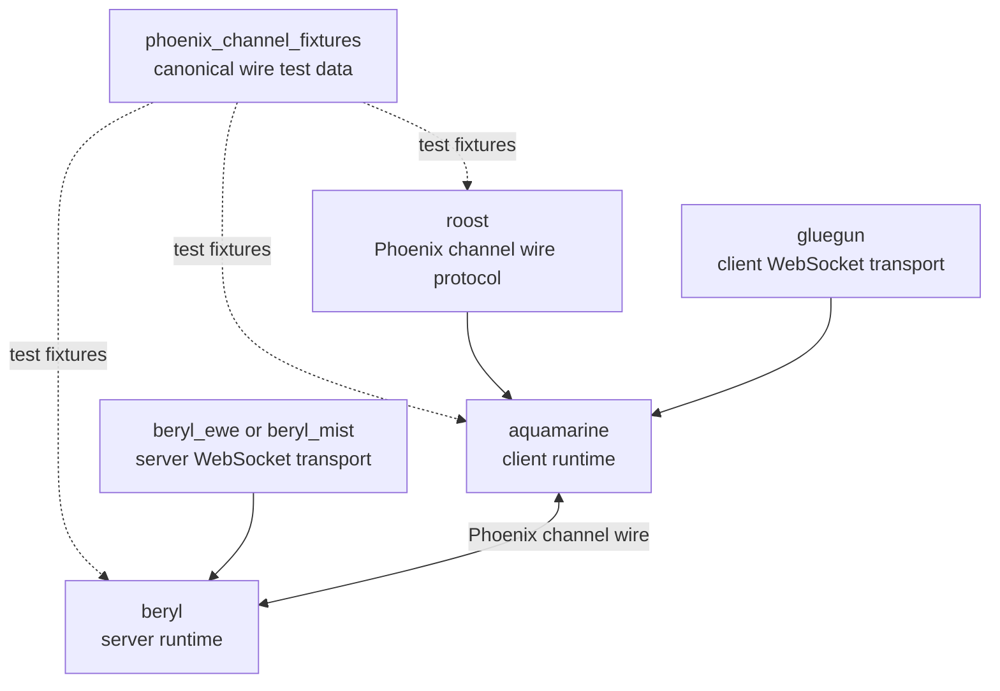

<table><tr>
<td></td>
<td><h1>beryl</h1>Type-safe real-time channels and presence for Gleam on the BEAM.</td>
</tr></table>

> [!IMPORTANT]
> beryl is not yet 1.0. Minor releases can change the API or remove features.
> Treat beryl as experimental. Try it and send feedback.

## System overview

beryl separates a portable channel state machine from its BEAM runtime and
WebSocket transports. Applications use typed socket dispatch or composed
channel handlers. The runtime manages processes, presence, and PubSub;
transport adapters perform WebSocket I/O. See the [package contracts](./packages/README.md)
for the interfaces and ownership boundaries.

## Install

GitHub hosts the current beryl packages. Hex does not. Add these dependencies
to `gleam.toml`:

```toml
[dependencies]
beryl = { git = "https://github.com/tylerbutler/beryl.git", ref = "main", path = "packages/beryl" }
beryl_ewe = { git = "https://github.com/tylerbutler/beryl.git", ref = "main", path = "packages/beryl_ewe" }
ewe = ">= 9.0.0 and < 10.0.0"
```

```sh
gleam deps download
```

`beryl` includes raw dispatch and the recommended `beryl/channel` composition
layer. The examples serve HTTP and WebSockets with [Ewe](https://hex.pm/packages/ewe)
and `beryl_ewe`. If your application uses Mist, use
[`beryl_mist` instead](https://beryl.tylerbutler.com/guides/websocket/#mist).

The `beryl`, `beryl_mist`, and `beryl_ewe` packages support the
**Erlang/BEAM** runtime. The separate `beryl_protocol` package supports Erlang
and JavaScript. It provides pure channel lifecycle transitions without
supervision, PubSub, or presence. See the
[Durable Object example](examples/portable_channels/README.md) for a
JavaScript host that uses Roost for Phoenix framing.

## Quick start

```gleam
import beryl
import beryl/transport/server
import beryl/wire
import beryl/channel
import beryl_ewe
import ewe
import gleam/erlang/process
import gleam/http/response
import gleam/json
import gleam/otp/static_supervisor

type State {
  State(room: String)
}

fn room_channel() -> channel.Handler {
  channel.handler("room:*", fn(context) {
    channel.accept(State(room: context.topic))
    |> channel.on_message(fn(state, message) {
      case wire.dynamic_to_json(message.payload) {
        Ok(payload) ->
          channel.next(state, [
            channel.discard_reply(message.reply),
            channel.broadcast(message.event, payload),
          ])
        Error(Nil) ->
          channel.next(state, [
            channel.reply_error(message.reply, json.string("Invalid JSON payload")),
          ])
      }
    })
  })
}

pub fn main() {
  let config =
    beryl.config(wire.phoenix_codec())
    |> beryl.with_frame_rate(per_second: 35, burst: 70)
    |> beryl.with_message_rate(per_second: 30, burst: 60)
  let assert Ok(#(channels, spec)) =
    channel.child_spec(config, handlers: [room_channel()])
  let assert Ok(_root) =
    static_supervisor.new(static_supervisor.OneForOne)
    |> static_supervisor.add(spec)
    |> static_supervisor.start()

  let assert Ok(_) =
    beryl_ewe.handler(channels, server.default_config("/socket/websocket"), fn(_req) {
      response.new(404) |> response.set_body(ewe.Empty)
    })
    |> ewe.new
    |> ewe.listening(on: 8000)
    |> ewe.start

  process.sleep_forever()
}
```

`beryl_ewe.handler` serves WebSockets and HTTP on one Ewe listener. It sends
WebSocket requests on `/socket/websocket` to beryl. Other requests go to the
HTTP fallback, which returns 404 here.

To run a full example with a Phoenix JavaScript client, follow
[Run the live poll](https://beryl.tylerbutler.com/quick-start/).
Then use the [live-poll tutorial](https://beryl.tylerbutler.com/tutorial/)
to learn how it works.

## Documentation

- **Website and guides**: <https://beryl.tylerbutler.com>
- **Generated API reference**: <https://beryl.tylerbutler.com/reference/api/>
- **Repository and git releases**: <https://github.com/tylerbutler/beryl>

## Ecosystem

beryl is a server runtime for real-time applications. It manages socket
registration, broadcasts, presence, groups, PubSub, and transport integration.
beryl has a pluggable wire codec. Shared conformance fixtures keep its Phoenix
codec compatible with Roost and Aquamarine.



| Package | Responsibility |
|---------|----------------|
| `phoenix_channel_fixtures` | Shared test fixtures for Phoenix channel wire compatibility. |
| `roost` | Phoenix channel frame constants, encode/decode helpers, and reply helpers. |
| `beryl` | Server-side runtime with its own pluggable codec; its Phoenix codec is fixture-tested. |
| `beryl/channel` | Typed channel composition module in the `beryl` package. |
| `aquamarine` | Client-side channel runtime that uses Roost for Phoenix compatibility. |

## Interface

`beryl.child_spec` and `beryl/channel.child_spec` construct supervised
application specifications. The Ewe and Mist adapters expose `upgrade` and `handler`;
both use `beryl/transport/server.TransportConfig`. The portable
`beryl_protocol.step` returns state and ordered actions for a host to execute.
The [package blueprint](./packages/README.md) links each interface to its source.

### Subdirectories and system boundaries

| Directory | Contract |
|---|---|
| [Packages](./packages/README.md) | Portable protocol, BEAM runtime, and Ewe/Mist adapters. |
| [Examples](./examples/README.md) | Runnable servers, browser clients, tutorial checkpoints, and a Durable Object host. |
| [Website](./website/README.md) | Astro/Starlight site, interactive demos, and documentation generators. |
| [Scripts](./scripts/README.md) | Dependency preparation, portable dependency checks, and Erlang FFI analysis. |
| [Load testing](./load/README.md) | k6 workloads, client lifecycle, and result reporting. |
| [Benchmarks](./benchmarks/README.md) | Opt-in codec fixtures and measurements. |
| [Design documentation](./docs/README.md) | Design notes and the Marp rendering hook. |

## Global invariants

- Keep protocol transitions separate from host I/O. Hosts supply time and
  connection identity and execute returned actions in order.
  (`packages/beryl_protocol/src/beryl_protocol.gleam:new`, `step`, `Action`)
- Supply a codec and preserve exact join/reply capabilities. Construct
  configuration through its public factory and builders.
  (`packages/beryl/src/beryl.gleam:config`,
  `packages/beryl/src/beryl/socket.gleam:JoinReference`, `ReplyReference`)
- Delegate adapter admission, frame handling, and cleanup to the shared
  transport server.
  (`packages/beryl/src/beryl/transport/server.gleam:init_connection`,
  `close_connection`)
- Keep `LocalNode` presence diffs local. PubSub participants sharing a scope
  must use compatible payloads and the scoped five-element wire tuple.
  (`packages/beryl/src/beryl/presence.gleam:DiffScope`,
  `packages/beryl/src/beryl/pubsub.gleam:send_to_pid`)
- The workspace bundles `beryl_protocol` into beryl. It excludes examples
  and benchmarks from release and keeps benchmark dependencies and execution
  opt-in. (`gleam.toml:tools.trellis.publish.bundle`,
  `gleam.toml:tools.trellis.exclude`)
- Edit generated API documentation at its Gleam source, then regenerate it.
  (`website/scripts/generate-reference.mjs:generateReference`)

## Global side effects

Starting a BEAM application creates supervised processes, queues, monitors,
and timers. Configured presence and PubSub change shared state and send
inter-node messages; adapters write WebSocket frames. The portable protocol
performs no I/O. See the [package effects](./packages/README.md#side-effects).

Example hosts can also change browser DOM state, write bundles, or persist
Durable Object state. Documentation generators write files and can invoke
tools or make a release-tag lookup. Dependency setup downloads packages;
load tests send traffic to the selected target. Read the corresponding
directory contract before running these commands.

## System verification

From the repository root, `just test` runs workspace tests, including beryl's
serial and distributed lanes. Workspace exclusions mean it does not cover
every example or benchmark (`justfile:test`, `test-distributed`,
`gleam.toml:tools.trellis.exclude.test`).

Use `just protocol-test` for both protocol targets, `just beam-check` for
Erlang FFI, and the child contracts for browser, portable-host, website, load,
and benchmark checks. `just ci` runs the main CI checks (`justfile:protocol-test`,
`beam-check`, `ci`).

## Features

- **Channels:** Register typed handlers by topic pattern. Each joined topic has
  private state and a typed server-message API.
- **App dispatch:** Use the core `init` and `update` API when you need direct
  control of the router.
- **Presence:** Track distributed presence with an add-wins observed-remove set
  CRDT.
- **Groups:** Broadcast to named groups of channels.
- **PubSub:** Publish and subscribe across Erlang nodes with `pg`.
- **Typed server messages:** Send a message to a socket through
  `Sender(msg)`. `update` receives it as `Info(msg)` without a cast.
- **WebSocket transport:** Use Ewe or Mist with the Phoenix wire protocol.
- **Connect hook:** Use socket-level `on_connect` authentication, similar to
  Phoenix `UserSocket.connect/3`. The hook runs once for each socket and can
  reject the connection before a join. `ConnectSeed` passes request data to
  `init`.

## Examples

The `examples/` directory includes these runnable demos. The
[example contracts](./examples/README.md) also cover tutorial checkpoints,
Lustre presence, the portable host, and shared helpers.

| Example | What it demonstrates |
|---------|----------------------|
| [`examples/cursors`](examples/cursors/) | App-side dispatch, topic wildcards, session presence, `BroadcastFrom`, rate limiting |
| [`examples/chatrooms`](examples/chatrooms/) | Channel handlers, auth, join rejection, replies, broadcasts, groups, validation, typing indicators |
| [`examples/collab_docs`](examples/collab_docs/) | Channel handlers, client-side CRDT document blocks, tenant/document topic validation, conflict resolution |
| [`examples/showcase`](examples/showcase/) | End-to-end `beryl/channel` composition across every subsystem |

See the [Examples page](https://beryl.tylerbutler.com/examples/) for a full
comparison.

## Send typed updates from an actor

A long-lived actor, such as a document session, can send updates to each joined
socket. Pass `socket.ConnectInfo.self` to a producer that can call
`socket.notify`; `update` receives the message as `socket.Info`.

```gleam
import beryl/overload
import beryl/socket

pub type Msg {
  DocUpdated(version: Int)
}

fn notify_socket(
  sender: socket.Sender(Msg),
  version: Int,
) -> Result(Nil, overload.AdmissionError) {
  socket.notify(sender, DocUpdated(version))
}
```

For channel handlers, pass `channel.JoinContext.self` and use `channel.notify`
to deliver to `on_info`. Handle admission errors in the producer.
Neither sender is a `Subject`, so these APIs cannot directly replace a
subscription that accepts only a `Subject`. See the
[backend integration guide](https://beryl.tylerbutler.com/guides/backend-integration/#send-typed-updates-to-one-socket)
for migration from the removed `beryl/bridge` module.

## Releases and changelog

See [GitHub Releases](https://github.com/tylerbutler/beryl/releases) for release
notes. Releases use
[Conventional Commits](https://www.conventionalcommits.org/). The project uses
[trellis](https://trellis.tylerbutler.com) changelog fragments. A fragment is
required only for what a released package ships. See
[DEV.md](DEV.md#when-a-fragment-is-required) for the rule.

## Security

beryl uses **Erlang distribution** for PubSub and presence replication. You
must trust **every node in the cluster**. Application and channel authorization
protect against untrusted WebSocket clients. They do **not** protect against a
hostile Erlang distribution peer. Such a peer can inject internal beryl
traffic and presence state.

Read **[SECURITY.md](SECURITY.md)** before you run beryl in production. It
explains:

- The Erlang distribution **trust boundary** and the effect of a compromised
  peer.
- Distribution security: a strong protected cookie, TLS distribution,
  EPMD and port firewall rules, and closed cluster membership.
- Why beryl trusts internal PubSub and presence messages but validates and
  rate-limits client WebSocket messages.
- The atom-table limit for `pubsub.config_with_scope`. Do not pass values from
  users to this function.

For controls against client abuse, such as rate limits, connection limits, and
origin checks, see the
[Production Hardening guide](https://beryl.tylerbutler.com/guides/production-hardening/).

### Required: an edge proxy frame-size limit

beryl applies the `with_max_inbound_frame_bytes` limit **after frame
assembly**. The WebSocket transport (Mist/gramps) buffers and assembles a full
frame before beryl measures it. beryl then rejects an oversized frame. This
limit controls the processing cost of one message. It does **not** limit
transport memory.

A hostile client can exhaust node memory through one connection in two ways:

- It can declare a large payload length in a frame header and send the body
  at a low rate.
- It can send many fragmented continuation frames that the transport puts in
  one buffer.

In both cases, the transport receive buffer has no size limit before beryl
checks the frame size. **beryl's per-connection frame-rate limit
(`with_frame_rate`) and per-socket message-rate limit (`with_message_rate`)
do not prevent this attack**. These limits run after frame assembly. The
per-IP connection limit (`with_max_connections_per_ip`) runs before the
WebSocket upgrade, but does not bound memory within an admitted connection.
The buffer can grow in one accepted connection before dispatch.

To limit transport memory in production, you **must** put an edge proxy or load
balancer in front of beryl. You can use nginx, HAProxy, Envoy, or a cloud load
balancer. Configure:

- A **maximum WebSocket frame or message size** that is not greater than the
  `with_max_inbound_frame_bytes` value.
- A matching **request or body size limit** for the first HTTP upgrade request.

Set the proxy to reject oversized frames before the BEAM node buffers them.
Use beryl's in-process limit as a second control for message processing cost.
Do not use it as a memory limit.

## Development

### Prerequisites

- [Erlang](https://www.erlang.org/) 27+
- [Gleam](https://gleam.run/) 1.13+
- [just](https://github.com/casey/just) (task runner)

Install tools via [mise](https://mise.jdx.dev/):

```sh
mise install
```

### Commands

```sh
just deps      # Download dependencies
just build     # Build the project
just test      # Run tests
just format    # Format code
just check     # Type check
just docs      # Build documentation
just ci        # Run all CI checks
```

### CI/CD

This project uses GitHub Actions for CI and releases:

- **CI:** Runs for each push and pull request to `main`.
- **PR validation:** Checks the PR title with commitlint, checks workspace
  rules with `trellis doctor`, and checks changelog fragments with
  `trellis changelog check`.
- **Release:** [trellis](https://trellis.tylerbutler.com) maintains a release
  PR from unreleased changelog fragments.
- **Publish:** Merging the release PR creates package tags and GitHub releases.
  Hex.pm publishing is disabled.

### GitHub Secrets Required

| Secret | Description |
|--------|-------------|
| `RELEASE_PAT` | GitHub PAT with `contents:write` and `pull-requests:write` permissions |

### Commit Convention

This project uses [Conventional Commits](https://www.conventionalcommits.org/):

- `feat:` - Adds a feature and causes a minor version increase.
- `fix:` - Fixes a defect and causes a patch version increase.
- `docs:` - Changes documentation.
- `chore:` - Performs maintenance.
- `BREAKING CHANGE:` in the commit body - Causes a major version increase.

## License

MIT. See [LICENSE](LICENSE).
